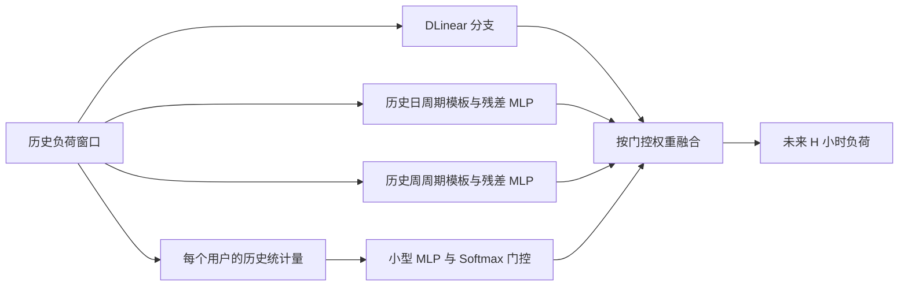

# 核心模型：PeriodGatedDLinear

这是本课程项目实现的组合模型名称，不代表已发表的新算法，也尚未证明优于基线。

## 任务和三个专家

历史输入为 $X\in\mathbb{R}^{B\times L\times C}$，输出为 $\hat Y\in\mathbb{R}^{B\times H\times C}$。本实验默认 $L=336$，$C=321$，$H\in\{24,96\}$，每步为一小时。数据按时间划分，所有用户分别使用训练段均值和标准差归一化。

### DLinear 分支

复用上游 DLinear 的移动平均分解，窗口默认 25：

$$X_t=\operatorname{MovingAverage}(X),\qquad X_s=X-X_t.$$

分别沿时间维度线性映射后相加：

$$\hat Y^{(0)}=\operatorname{Linear}_s(X_s)+\operatorname{Linear}_t(X_t).$$

这部分来自 DLinear，论文中须引用原方法：**Are Transformers Effective for Time Series Forecasting?**, AAAI 2023；官方实现：https://github.com/cure-lab/LTSF-Linear 。

### 历史日/周周期分支

对周期 $P\in\{24,168\}$，只使用最近 $n_P=\lfloor L/P\rfloor$ 个完整历史周期。设 $j=0,\ldots,P-1$，模板为：

$$T^{(P)}_{b,c,j}=\frac{1}{n_P}\sum_{i=0}^{n_P-1}X_{b,L-n_PP+iP+j,c}.$$

日模板平均最近 14 个完整日周期；周模板平均最近两个完整周周期。窗口长度不能覆盖启用的周期时，模型明确报错。

共享于所有用户的小型 MLP 学习模板的残差修正：

$$U^{(P)}=T^{(P)}+W^{(P)}_2\operatorname{GELU}(W^{(P)}_1T^{(P)}+b^{(P)}_1)+b^{(P)}_2.$$

训练时在 GELU 后使用 dropout。最后一层零初始化，因此周期分支最初等价于历史周期均值。预测模板按相位延拓：

$$\hat Y^{(P)}_{b,h,c}=U^{(P)}_{b,c,h\bmod P},\qquad h=0,\ldots,H-1.$$

该模板以历史窗口末端对齐未来预测起点。即使预测跨度超过 24 或 168 步，也不读取预测区间内的真实值。

### 输入相关门控

每个样本、每个用户都提取 8 项历史特征：全窗口均值、总体标准差、最后观测、最近 24 步均值、最近 24 步总体标准差、首尾差、24 步滞后平均绝对差、168 步滞后平均绝对差。

特征只依赖预测起点之前的历史。门控 MLP 共享于所有用户：

$$\alpha_{b,c}=\operatorname{Softmax}\left(W_{g,2}\operatorname{GELU}(W_{g,1}s_{b,c}+b_{g,1})+b_{g,2}\right).$$

最终预测：

$$\hat Y_{b,h,c}=\alpha_{b,c,0}\hat Y^{(0)}_{b,h,c}+\alpha_{b,c,1}\hat Y^{(24)}_{b,h,c}+\alpha_{b,c,2}\hat Y^{(168)}_{b,h,c}.$$

权重对专家求和为 1。**同一用户在同一个预测窗口内，共用一组跨预测跨度的权重**；当前实现不是逐预测步门控。动态门控最后一层采用小随机权重，并设置 DLinear 的偏置为 2、其他专家为 0，以初始偏好 DLinear；全局可学习门控使用相同的偏置初值。

## 经典循环网络对照

LSTM 与 GRU 都接收完整多变量窗口，由最后一层的最终隐藏状态通过一个线性输出头一次性预测 $H\times C$ 个数值。默认两层、隐藏维度 64、层间 dropout 0.1。二者不使用周期分支或门控。

循环网络可混合用户信息，核心模型则共享单用户预测结构和门控参数。因此比较时需要同时报告参数量、误差、训练时间和显存，不能声称参数规模完全相同。

## 消融含义

| 运行名称 | 对应结构 | 检验目的 |
| --- | --- | --- |
| DLinear / NoPeriod | 原 DLinear / 只保留核心模型的 DLinear 分支 | 基线与接口等价性 |
| Daily | DLinear + 日分支 + 动态门控 | 日分支作用 |
| Weekly | DLinear + 周分支 + 动态门控 | 周分支作用 |
| Uniform | 三专家固定等权平均 | 朴素融合对照 |
| Static | 三专家全局可学习权重，对所有样本/用户相同 | 相对于动态门控，检验输入依赖性 |
| Core | 三专家输入相关门控 | 完整模型 |

Daily/Weekly 仅移除相应预测分支，动态门控的 8 项输入特征保持统一；这不是“完全移除所有日/周先验”的实验。Uniform 与 Static 的初值不同；研究输入相关门控时，以 Static 与 Core 的比较为主要证据，Uniform 提供简单平均对照。

## 数据边界和论证范围

- 历史输入来自预测起点之前；LSTM、GRU、核心模型均不读取未来 decoder 数值。
- 模板和门控只依赖输入窗口，无须访问完整数据集中的未来时间点。
- 标准化只拟合训练段，验证集用于选最优 epoch，测试集不参与训练过程中的模型选择。
- 官方预处理 CSV 时间索引与原始采集年份不同，因此当前使用相对 24/168 步周期，不引入真实节假日或未经核对的天气记录。
- 参数共享和周期模板是结构选择，性能、泛化与新颖性仍需正式实验和文献核查；不能仅凭短训练声称有效。
